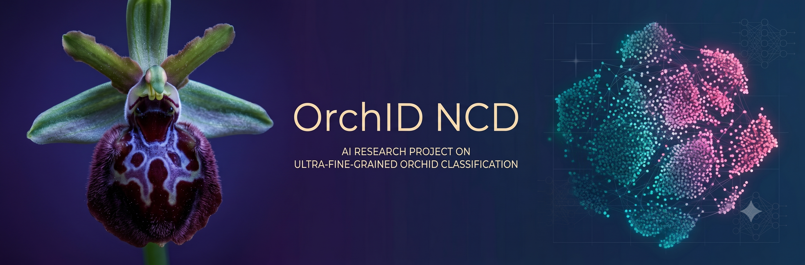

[English](README.md)

<p align="center">
  
</p>

<p align="center">
  
  
  
  
  <br/>
  <em>Classificazione ultra-fine-grained e Novel Class Discovery per orchidee <b>Ophrys</b></em>
</p>

<p align="center">
  <strong>Tesi magistrale — Università degli Studi di Napoli Federico II (DIETI)</strong>
  <br/>
  <a href="https://marcellorusso-orchid-ncd.hf.space">Demo Live</a> ·
  <a href="https://github.com/squidslab/OrchID">GitHub</a> ·
  <a href="https://arxiv.org/abs/2503.08049">Articolo SpHOR</a>
</p>

---

## Abstract

Sei specie di *Ophrys* morfologicamente simili, una classe novel nascosta (*O. sphegodes* Napoli), 2.232 immagini di training. Confrontiamo 6 backbone (ResNet‑18/50, ConvNeXt‑T/S, DINOv2‑S/B) × 4 metodi (CE baseline, SupCon, SpHOR, MGH‑NCD) su classificazione ultra-fine-grained e open-set detection. **Risultato migliore: DINOv2‑Base + MGH‑NCD — 0.859 Test F1, 0.914 AUROC per rilevamento classe novel.**

---

## Risultati

### Classificazione (Test F1)

| Modello | CE (Exp 6) | SupCon (Exp 7) | SpHOR (Exp 8) | MGH‑NCD (Exp 10) |
|---------|:----------:|:--------------:|:--------------:|:-----------------:|
| **DINOv2‑Base** | **0.911** | **0.933** | **0.930** | **0.859** |
| DINOv2‑Small | 0.884 | 0.913 | 0.917 | 0.850 |
| ConvNeXt‑Tiny | 0.701 | 0.844 | 0.815 | 0.602 |
| ConvNeXt‑Small | 0.527 | 0.704 | 0.698 | 0.561 |
| ResNet‑50 | 0.887 | 0.383 | 0.540 | 0.385 |
| ResNet‑18 | 0.860 | 0.363 | 0.398 | 0.386 |

### Rilevamento Classe Novel (AUROC, detector Ensemble)

| Modello | SupCon (Exp 7) | SpHOR (Exp 8) | MGH‑NCD (Exp 10) |
|---------|:-------------:|:--------------:|:-----------------:|
| **DINOv2‑Base** | 0.624 | 0.912 | **0.914** |
| DINOv2‑Small | 0.584 | 0.902 | 0.815 |
| ConvNeXt‑Tiny | 0.567 | 0.792 | 0.849 |
| ConvNeXt‑Small | 0.551 | 0.785 | 0.846 |
| ResNet‑50 | 0.610 | 0.638 | 0.730 |
| ResNet‑18 | 0.553 | 0.554 | 0.680 |

Classe novel: *O. sphegodes* Napoli (esclusa dal training).

---

## Risultati Principali

- **L'efficacia di SupCon dipende dall'allineamento del pretraining del backbone.** DINOv2 (self-supervised) e ConvNeXt (supervised su larga scala) beneficiano di SupCon (+3–20% Test F1). **ResNet‑18/50 collassano con SupCon** (~0.38 vs 0.87 Test F1) perché le loro features ImageNet mancano dell'allineamento contrastivo necessario per separare classi ultra-fine-grained con pochi campioni. Il pretraining self-supervised di DINOv2 su 142M immagini fornisce embedding che SupCon può raffinare efficacemente.
- **SpHOR migliora l'open-set detection senza sacrificare la classificazione.** DINOv2‑Base: 0.912 AUROC (SpHOR) vs 0.624 (SupCon) — i prototipi ortogonali sferici strutturano esplicitamente lo spazio latente per il rifiuto delle classi ignote.
- **MGH‑NCD eguaglia SpHOR nella detection ma è più robusto con backbone deboli.** L'hard-negative mining previene il collasso osservato con SupCon: ResNet‑18/50 AUROC passa da ~0.55 a ~0.70, ConvNeXt‑T/S da ~0.57 a ~0.85.
- **MGH‑NCD sacrifica accuratezza di classificazione per robustezza nella detection.** L'hard-negative mining distorce lo spazio latente, riducendo il Test F1 di DINOv2‑Base da 0.930 (SpHOR) a 0.859. È un trade-off atteso — il modello privilegia la separabilità delle feature per il rifiuto dell'ignoto rispetto alla compattezza intra-classe.
- **Modello migliore per rilevamento classe novel: DINOv2‑Base + MGH‑NCD** — 0.859 Test F1 (classificazione), 0.914 AUROC (rilevamento classe novel).

---

## Avvio Rapido

### Prerequisiti
- Python 3.10+, Node.js 20+
- GPU NVIDIA (solo training; inferenza CPU supportata)
- [Opzionale] Docker

### Sviluppo Locale

```bash
# Backend
cd backend
pip install -e ".[dev]"
python server.py            # → http://localhost:5000

# Frontend
cd frontend
npm install
npm run dev                 # → http://localhost:5175
```

Login con `marcello` / `orchid-2026` (creato automaticamente al primo avvio).

### Training

```bash
cd backend
python cli.py --cross-validate --exp 6 --model resnet18    # CE baseline
python cli.py --cross-validate --exp 7 --model resnet18    # SupCon
python cli.py --cross-validate --exp 8 --model resnet18 --sphor   # SpHOR
python cli.py --cross-validate --exp 10 --model dinov2_base        # MGH-NCD
python cli.py --ncd --exp 10 --model dinov2_base                  # Valutazione NCD
```

Vedi [AGENTS.md](AGENTS.md) per il riferimento completo dei comandi.

---

## Esperimenti

| Exp | Metodo | Fasi | Descrizione |
|-----|--------|:----:|-------------|
| 6 | CE baseline | 1 (CE) | Cross-entropy standard, backbone + testa insieme |
| 7 | SupCon | 2 (SupCon → CE) | Pretraining contrastivo supervisionato → linear probe |
| 8 | SpHOR | 2 (SupCon+SpHOR → CE) | Prototipi ortogonali sferici per regolarizzazione open-set |
| 10 | MGH‑NCD | 2 (MGH‑SupCon → CE) | Hard-negative mining + features multi-granularità |

Tutti gli esperimenti usano 5-fold stratified cross-validation con seed 57.

**Backbone (6):** ResNet‑18/50, ConvNeXt‑Tiny/Small, DINOv2‑Small/Base.

---

## Dataset

Sei specie di *Ophrys* criptiche + una classe novel nascosta:

| Specie | Train | Test | Novel |
|--------|:-----:|:----:|:-----:|
| O. exaltata | ✓ | ✓ | |
| O. garganica | ✓ | ✓ | |
| O. incubacea | ✓ | ✓ | |
| O. majellensis | ✓ | ✓ | |
| O. sphegodes | ✓ | ✓ | |
| O. sphegodes Palena | ✓ | ✓ | |
| **O. sphegodes Napoli** | | ✓ | **✓** |

Download da HuggingFace:
```python
from huggingface_hub import snapshot_download
snapshot_download("marcellorusso/orchid-ncd-dataset", repo_type="dataset")
```

---

## Architettura

```
Frontend (React+Vite) ────→ Backend (FastAPI) ────→ Model Registry (PyTorch)
                                │
                                ↓
                           SQLite DB
                      (Metadati, utenti)
```

**Storage:**
- **Metadati**: SQLite (`data/orchid.db`) — esperimenti, fold, utenti
- **Pesi modelli**: HuggingFace Hub (`marcellorusso/orchid-ncd-models`) — 144 file `.pt` (5 fold × 6 modelli × 4 exp + adapter)
- **Dataset**: Filesystem + HuggingFace Datasets
- **Embedding**: File NPY per esperimento (attivazioni cached per NCD)

---

## API

| Endpoint | Metodo | Auth | Descrizione |
|----------|--------|------|-------------|
| `/auth/login` | POST | — | Login |
| `/auth/register` | POST | — | Registrazione (codice invito) |
| `/classify` | POST | — | Classifica immagine (base64) |
| `/classify/models` | GET | — | Modelli disponibili |
| `/api/experiments` | GET | — | Elenco esperimenti |
| `/api/experiments/{id}` | GET | — | Dettaglio esperimento con fold |
| `/api/experiments/{id}/fold/{n}` | GET | — | Dati singola fold |
| `/api/comparison/experiments` | GET | — | Confronto tra esperimenti |
| `/api/ncd/comparison` | GET | — | Tabella risultati NCD |
| `/api/embeddings` | GET | — | Dati visualizzatore spazio latente |
| `/api/species` | GET | — | Specie con conteggio immagini |
| `/api/admin/sync-db` | POST | Admin | Forza sync SQLite da JSON |
| `/docs` | GET | — | Swagger UI |

---

## Link

- **Demo live:** [marcellorusso-orchid-ncd.hf.space](https://marcellorusso-orchid-ncd.hf.space)
- **GitHub:** [squidslab/OrchID](https://github.com/squidslab/OrchID)
- **Modelli:** `marcellorusso/orchid-ncd-models`
- **Dataset:** `marcellorusso/orchid-ncd-dataset`

## Licenza

[MIT](LICENSE)
