[🇬🇧 English](README.md)

# 🌸 OrchID — Representation Learning delle Orchidee

> Costruire uno spazio vettoriale strutturato delle specie di orchidee *Ophrys* tramite apprendimento contrastivo e tecniche di metric embedding.

---

## 🎯 Roadmap

| Fase | Obiettivo | Stato |
|------|-----------|-------|
| **F1 — Classificazione** | Baseline ResNet18/50, esperimenti domain shift, k-fold CV | ✅ Completata |
| **F2 — Spazio Vettoriale** | Apprendimento contrastivo (SimCLR, Triplet Loss, SupCon) per costruire uno spazio vettoriale strutturato | 🔜 Prossima |
| **F3 — Retrieval & Similarità** | Ricerca nearest-neighbor, clustering specie, detection classi sconosciute | 📋 Pianificata |

---

## 🌿 Specie

| | Specie |
|---|--------|
| 🌸 | *Ophrys exaltata* |
| 🌺 | *Ophrys garganica* |
| 🌻 | *Ophrys incubacea* |
| 🌼 | *Ophrys majellensis* |
| 🌷 | *Ophrys sphegodes* |
| 🌱 | *Ophrys sphegodes* (Palena) |

---

## 📸 Galleria

### *Ophrys exaltata*
<p float="left">
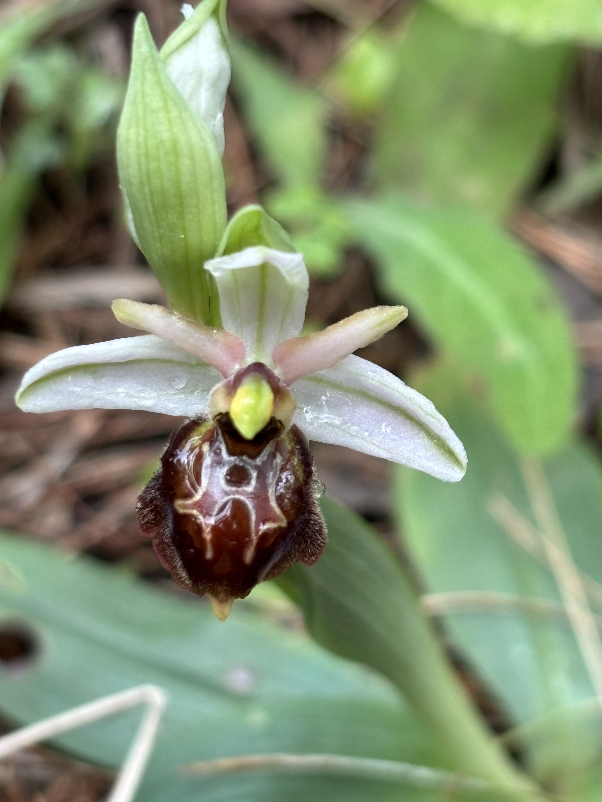

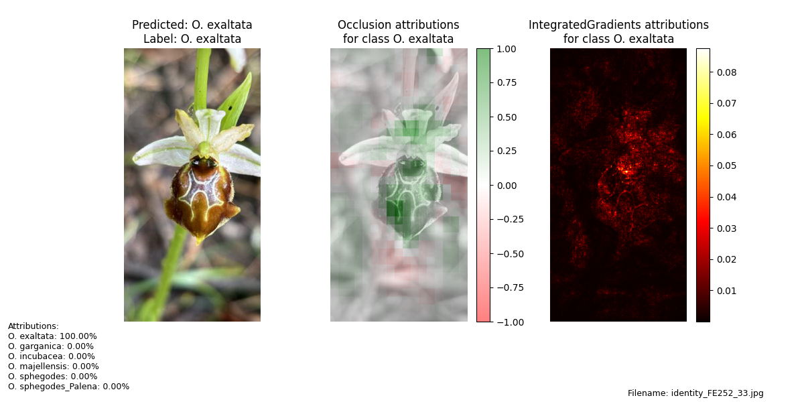
</p>

### *Ophrys garganica*
<p float="left">
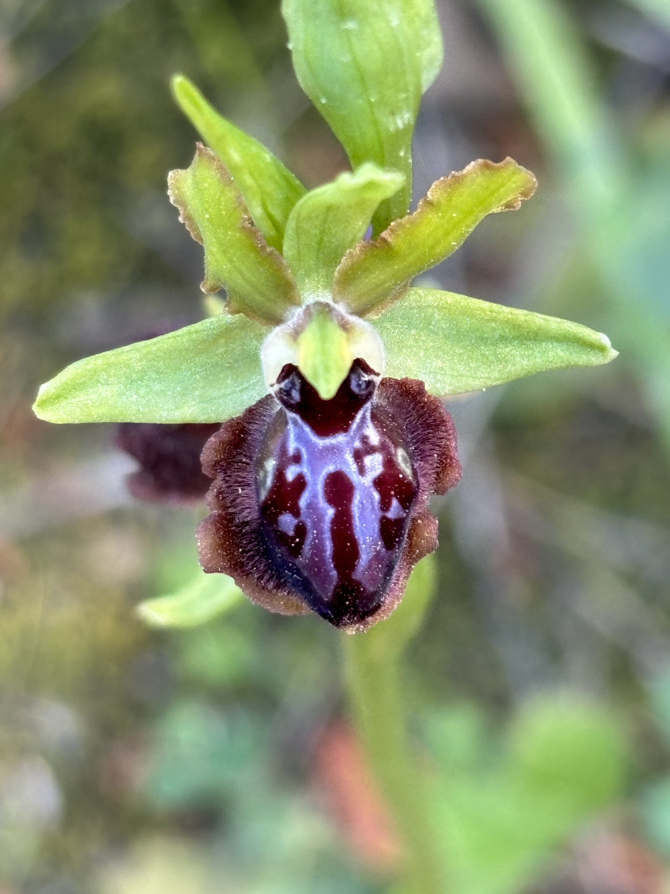

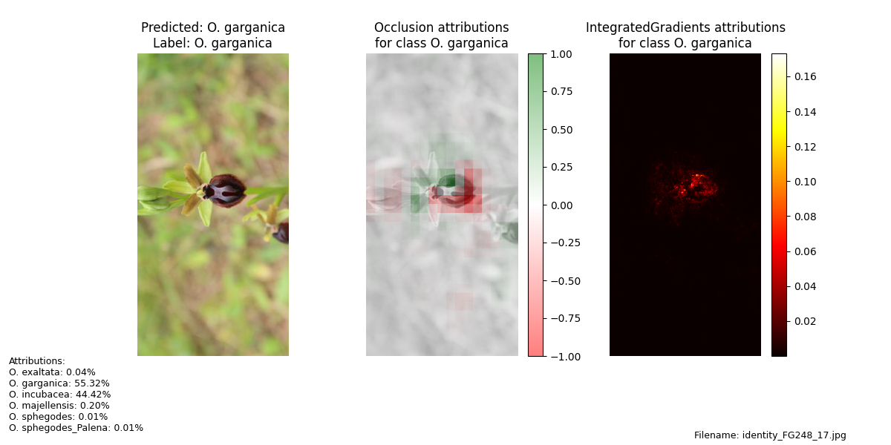
</p>

### *Ophrys incubacea*
<p float="left">
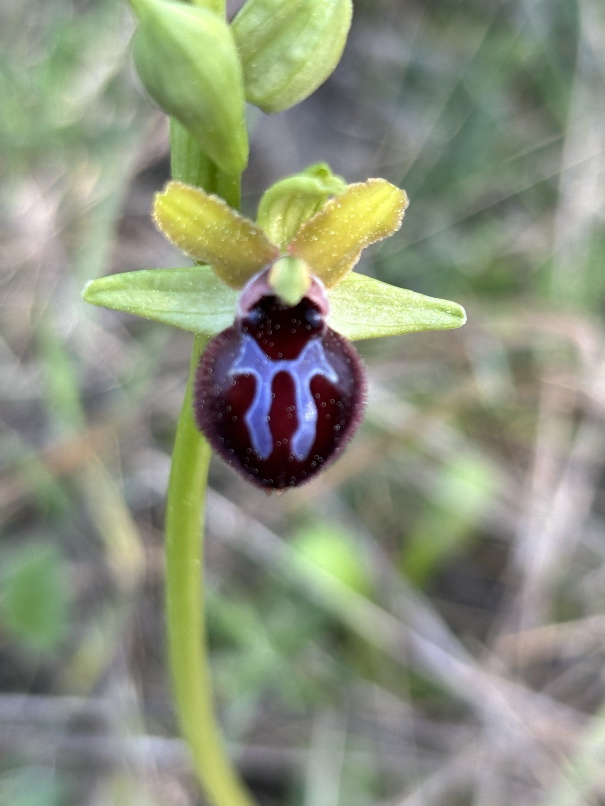
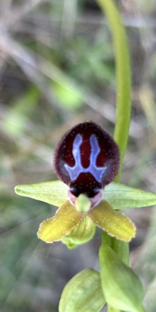
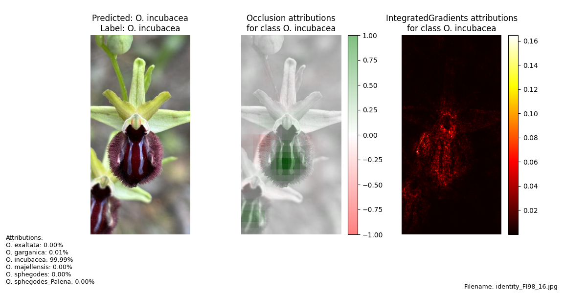
</p>

<details>
<summary>Vedi tutte le specie</summary>

### *Ophrys majellensis*
<p float="left">
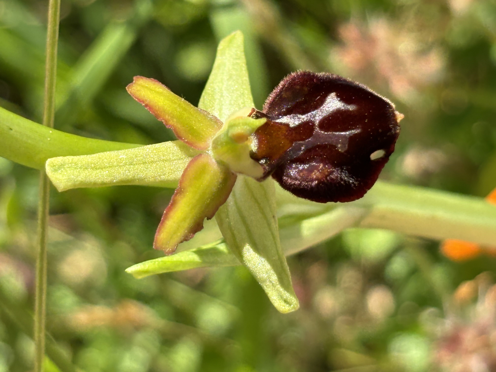
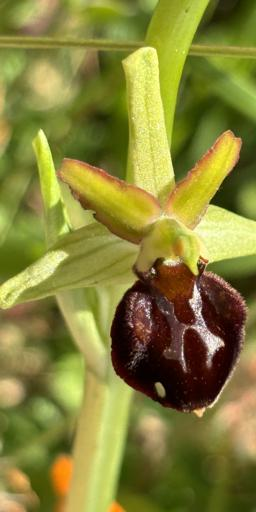
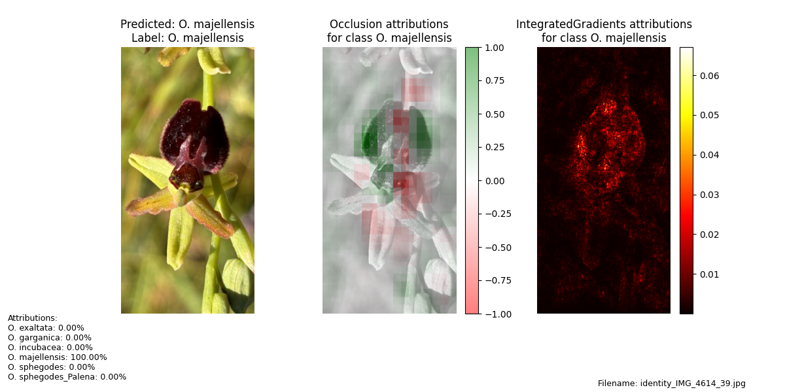
</p>

### *Ophrys sphegodes*
<p float="left">
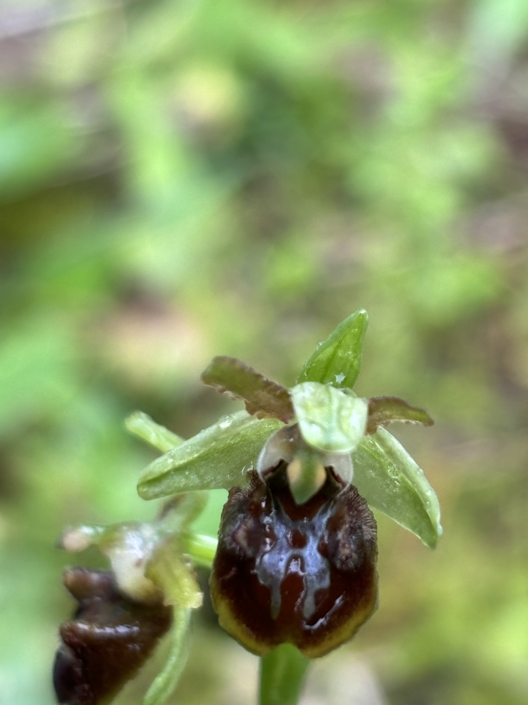
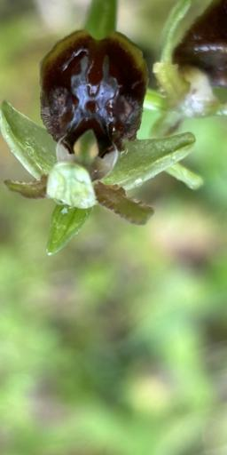
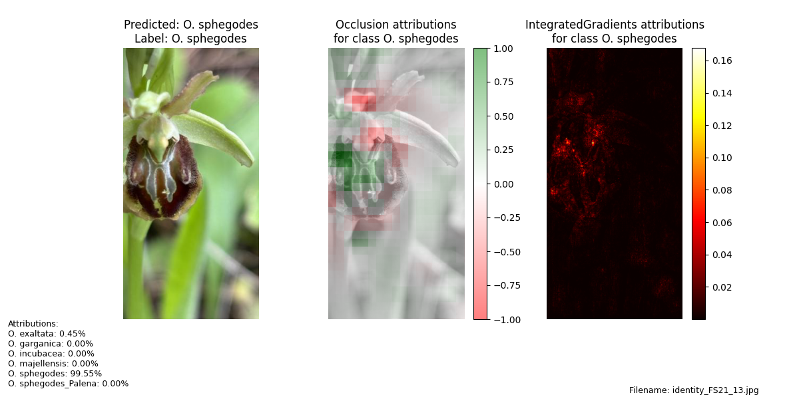
</p>

### *Ophrys sphegodes* (Palena)
<p float="left">
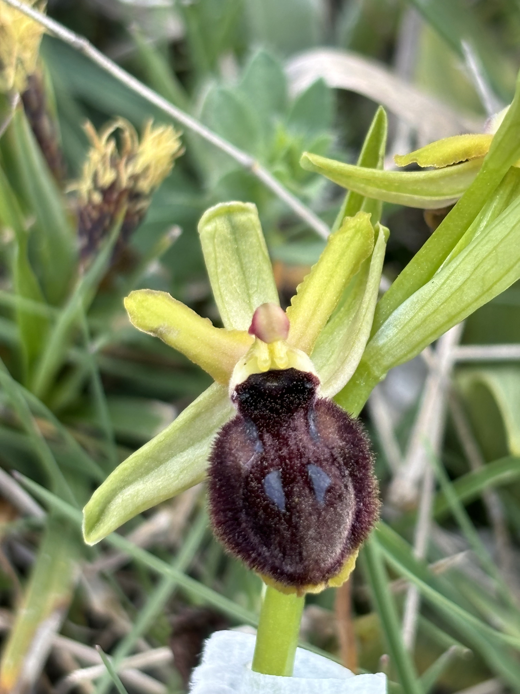

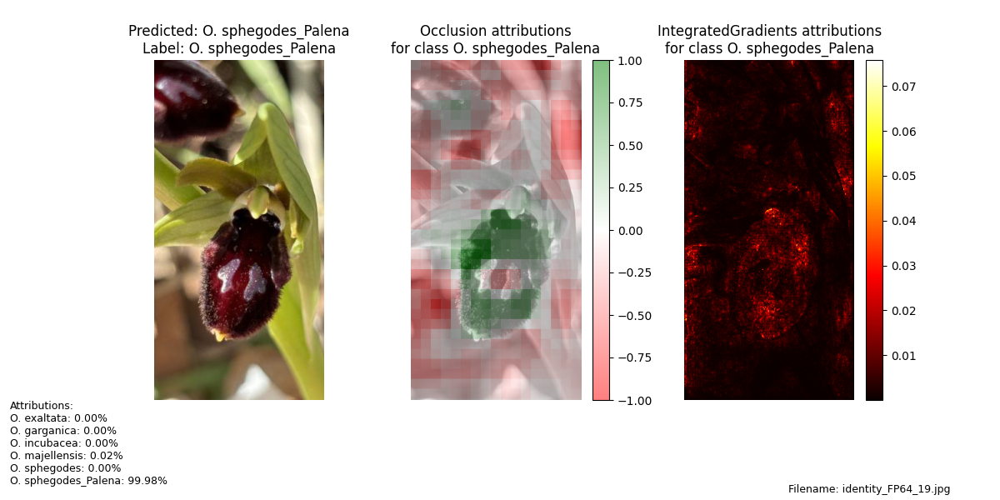
</p>

</details>

---

## 📊 Risultati — Fase 1 (Classificazione)

### K-Fold Cross-Validation (5-fold, dataset combinato)

| Modello | Val Accuracy | Val F1 | Test Accuracy | Test F1 |
|---------|-------------|--------|---------------|---------|
| ResNet18 | 86.97% ± 1.43% | 84.85% ± 1.72% | 97.69% | 97.74% |
| ResNet50 | 85.18% ± 1.89% | 84.85% ± 1.72% | 97.41% | 97.67% |

<details>
<summary>Esperimenti di domain shift</summary>

| Esperimento | Train | Test | Accuracy | F1 Macro | Note |
|-------------|-------|------|----------|----------|------|
| Exp1 | Privato | Privato | 94.78% | 93.72% | Baseline (6 classi) |
| Exp2 | Privato | Internet Raw | 35.09% | 37.57% | Domain shift forte |
| Exp3 | Privato | Internet Cropped | 48.15% | 50.43% | Il cropping aiuta |
| **Exp4** | **Combined** | **Internet Cropped** | **95.19%** | **95.37%** | **Miglior su internet** |
| **Exp5** | **Combined** | **Privato** | **96.79%** | **95.83%** | **Nessun forgetting** |

**Risultati chiave:**

1. Il domain shift fa scendere F1 da 93.72% a 37.57%
2. Il cropping recupera +12.9%
3. Il training combined recupera +44.9% (F1 → 95.37%)
4. Nessun catastrophic forgetting (F1 93.72% → 95.83%)

</details>

---

## 🚀 Avvio Rapido

### Prerequisiti

- Linux (testato su Ubuntu/Pop!_OS)
- Podman (o Docker) + NVIDIA GPU + Container Toolkit

### Esecuzione

```bash
git clone https://github.com/squidslab/OrchID.git
cd OrchID/resnet18

# Avvia il container
podman compose up -d --build

# Jupyter: http://localhost:8888
```

### CLI

```bash
cd backend

python cli.py --status                              # Verifica stato
python cli.py --all                                  # Esegui tutti gli esperimenti

# K-fold cross-validation
python cli.py --cross-validate --exp 4 --model resnet50 --epochs 100 --patience 15

# Fold singolo (per k-fold lunghi)
python cli.py --cross-validate --exp 4 --model resnet50 --fold 1
python cli.py --cross-validate --exp 4 --model resnet50 --aggregate-only

# Visualizzazione
python cli.py --plot experiments/exp4_combined_internet_cropped_100ep/
python cli.py --plot all
```

---

## 🏗️ Struttura Progetto

```
resnet18/
├── backend/                      # Codice applicazione
│   ├── app/                      # Codice sorgente (modulare)
│   │   ├── core/                 # Moduli ML core
│   │   │   ├── models/           # Classificatore ResNet (pattern ABC)
│   │   │   ├── training.py       # Loop di training
│   │   │   ├── evaluation.py     # Metriche e valutazione
│   │   │   └── kfold/            # K-fold cross-validation
│   │   ├── cli/                  # Interfaccia CLI
│   │   ├── api/                  # Endpoint FastAPI
│   │   ├── preprocessing/        # Preprocessing dati
│   │   ├── explainability/       # Captum explainability
│   │   └── visualization/        # Generazione grafici (ggplot, 300 DPI)
│   ├── tests/                    # Test unitari (112 test)
│   ├── experiments/              # Risultati esperimenti
│   ├── notebooks/                # Jupyter notebook
│   ├── cli.py                    # Entry point CLI
│   ├── server.py                 # Entry point API server
│   └── requirements.txt
├── Dockerfile
├── podman-start.sh
├── docs/
└── assets/
```

---

## 🔧 Stack Tecnologico

| | Componente |
|---|------------|
| 🧠 | PyTorch 2.1.0 + CUDA 11.8 |
| 🏛️ | ResNet18/50 (pre-addestrata ImageNet) |
| 🔍 | Captum (explainability) |
| 📦 | Podman + NVIDIA Container Toolkit |

---

## 📡 API

```bash
cd backend
python server.py                    # Avvia API su porta 5000
```

| Endpoint | Metodo | Descrizione |
|----------|--------|-------------|
| `/health` | GET | Health check |
| `/classify` | POST | Classifica immagine (base64) |
| `/docs` | GET | Documentazione OpenAPI |

---

## 📄 Licenza

Vedi [LICENSE](LICENSE).
