[🇮🇹 Italiano](README.it.md)

# 🌸 OrchID — Orchid Representation Learning

> Learning structured vector spaces of *Ophrys* orchid species through contrastive learning and metric embedding techniques.

---

## 🎯 Roadmap

| Phase | Goal | Status |
|-------|------|--------|
| **P1 — Classification** | ResNet18/50 baseline, domain shift experiments, k-fold CV | ✅ Done |
| **P1b — Experiment Explorer** | React SPA dashboard, classification upload, explainability heatmap, species stats, model selector | ✅ Done |
| **P2 — Embedding Space** | Contrastive learning (SimCLR, Triplet Loss, SupCon) to build a structured orchid vector space | 🔜 Next |
| **P3 — Retrieval & Similarity** | Nearest-neighbor search, species clustering, unknown class detection | 📋 Planned |

---

## 🌿 Species

| | Species |
|---|---------|
| 🌸 | *Ophrys exaltata* |
| 🌺 | *Ophrys garganica* |
| 🌻 | *Ophrys incubacea* |
| 🌼 | *Ophrys majellensis* |
| 🌷 | *Ophrys sphegodes* |
| 🌱 | *Ophrys sphegodes* (Palena) |

---

## 📸 Gallery

### *Ophrys exaltata*
<p float="left">
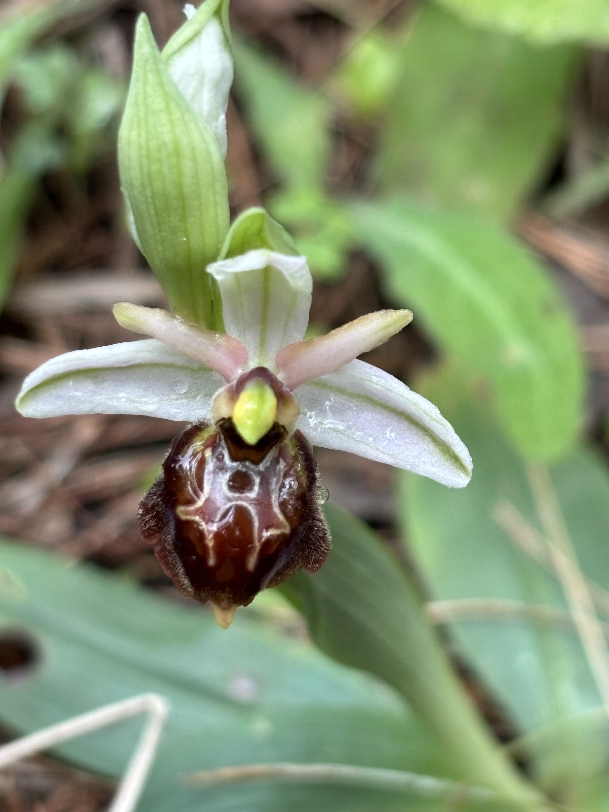

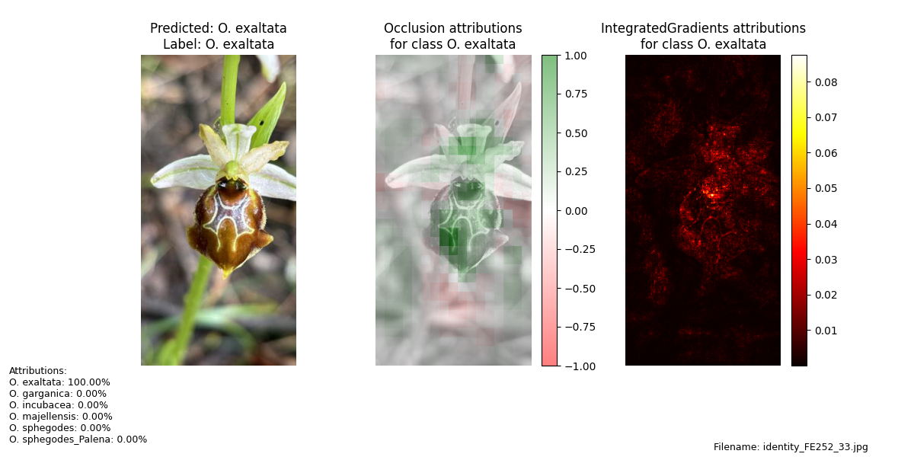
</p>

### *Ophrys garganica*
<p float="left">
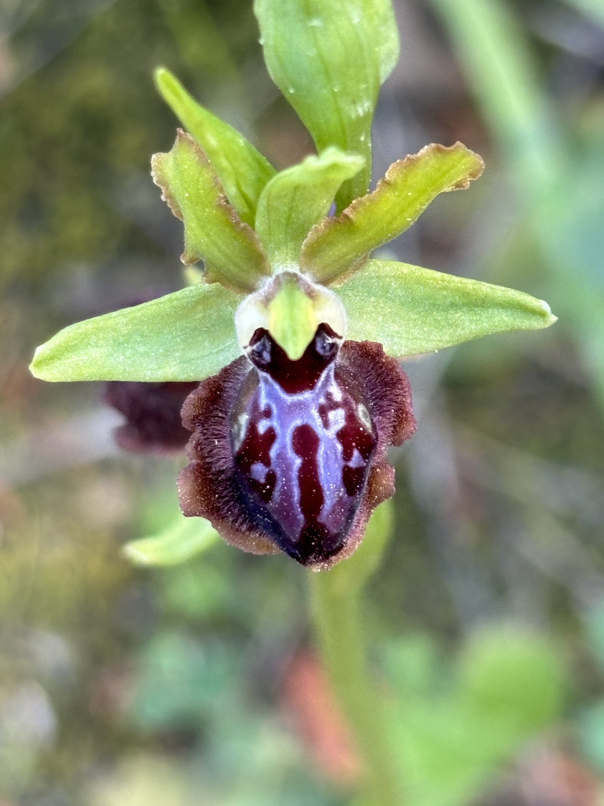
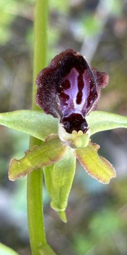
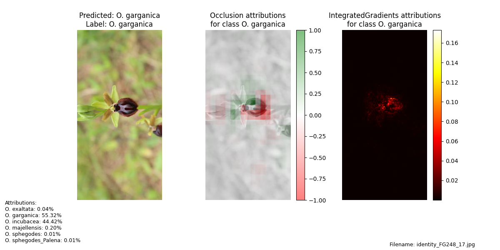
</p>

### *Ophrys incubacea*
<p float="left">
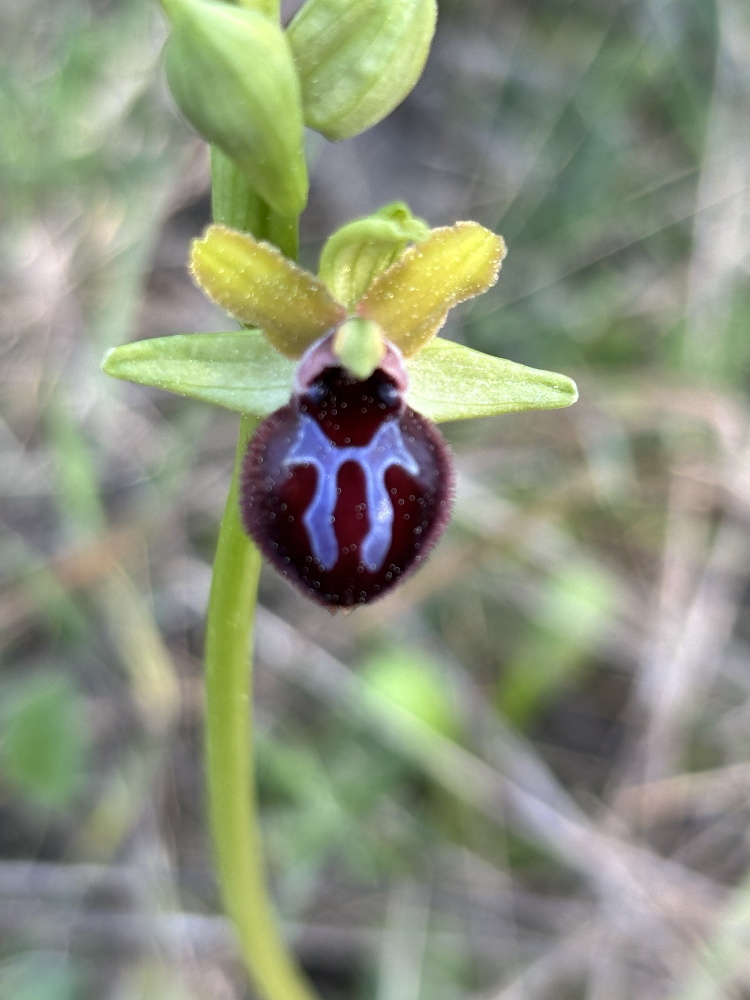
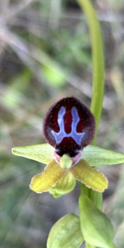
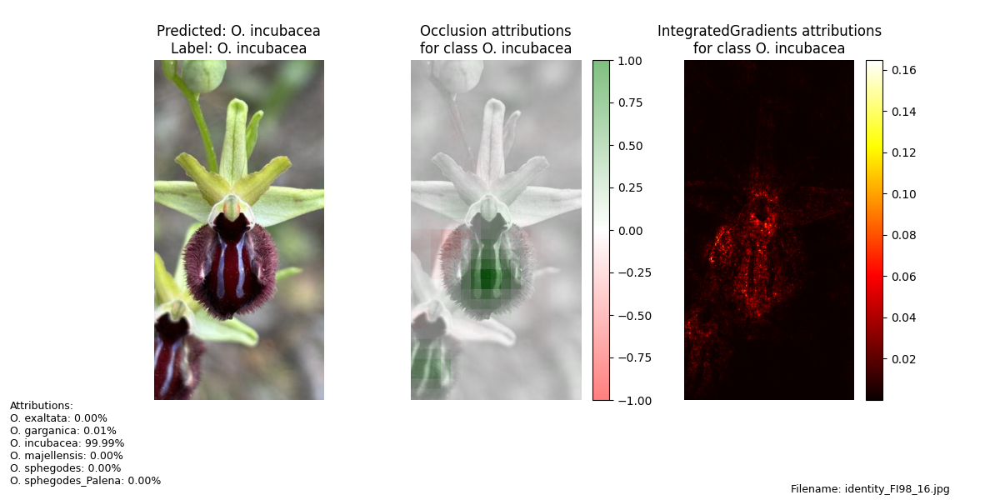
</p>

<details>
<summary>See all species</summary>

### *Ophrys majellensis*
<p float="left">


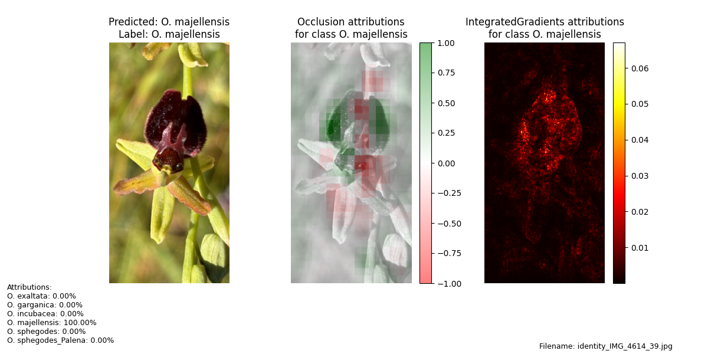
</p>

### *Ophrys sphegodes*
<p float="left">
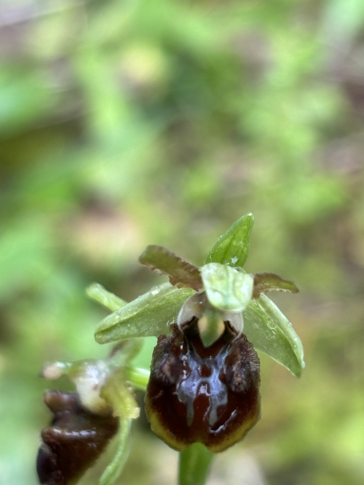

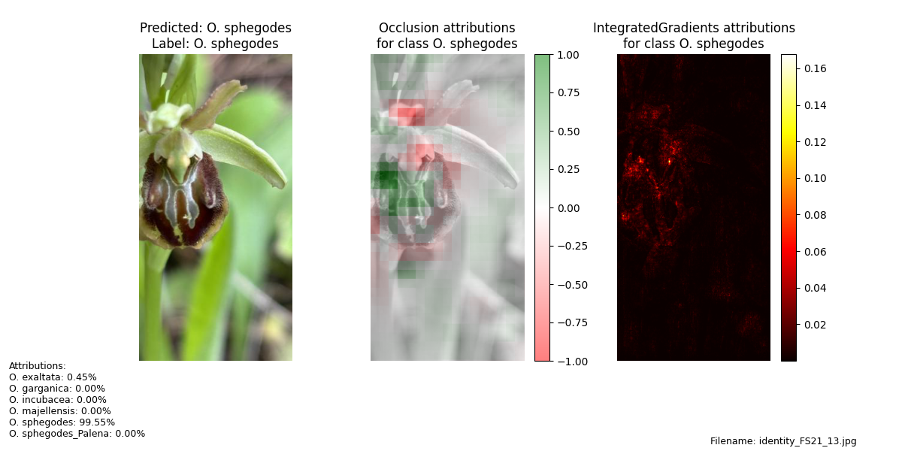
</p>

### *Ophrys sphegodes* (Palena)
<p float="left">
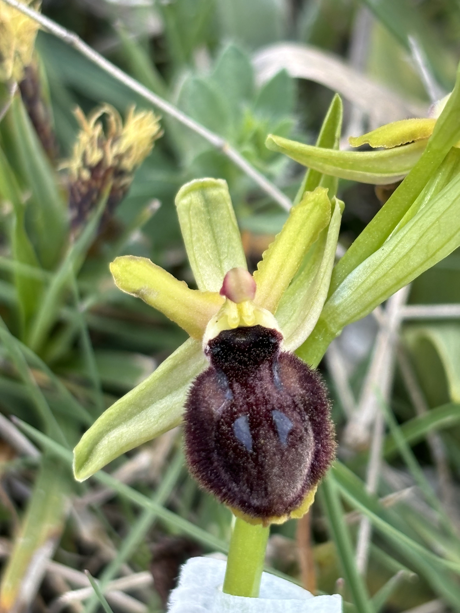
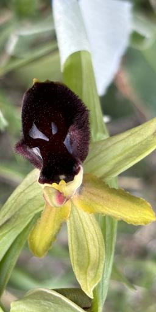
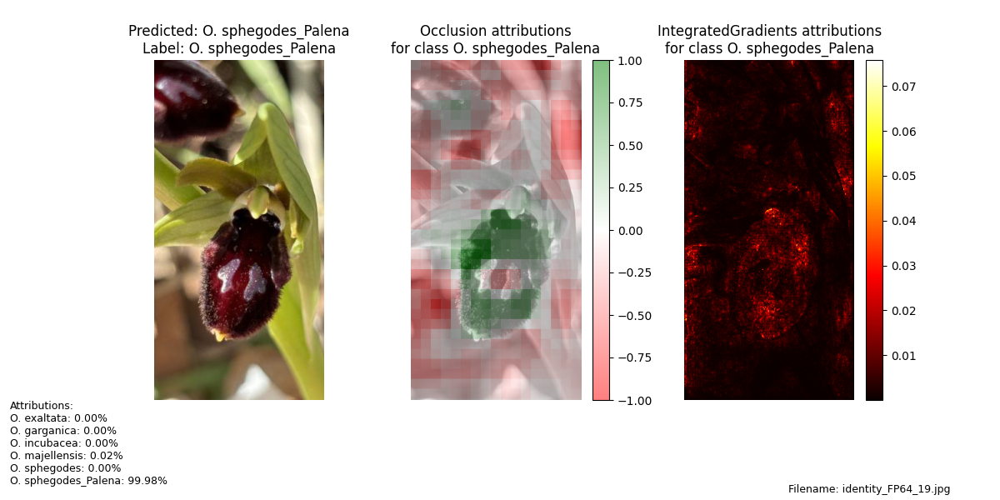
</p>

</details>

---

## 📊 Results — Phase 1 (Classification)

### K-Fold Cross-Validation (5-fold, combined dataset)

| Model | Val Accuracy | Val F1 | Test Accuracy | Test F1 |
|-------|-------------|--------|---------------|---------|
| ResNet18 | 86.97% ± 1.43% | 84.85% ± 1.72% | 97.69% | 97.74% |
| ResNet50 | 85.18% ± 1.89% | 84.85% ± 1.72% | 97.41% | 97.67% |

<details>
<summary>Domain shift experiments</summary>

| Experiment | Train | Test | Accuracy | F1 Macro | Notes |
|------------|-------|------|----------|----------|-------|
| Exp1 | Private | Private | 94.78% | 93.72% | Baseline (6 classes) |
| Exp2 | Private | Internet Raw | 35.09% | 37.57% | Strong domain shift |
| Exp3 | Private | Internet Cropped | 48.15% | 50.43% | Cropping helps (+12.9%) |
| **Exp4** | **Combined** | **Internet Cropped** | **95.19%** | **95.37%** | **Best on internet (+44.9%)** |
| **Exp5** | **Combined** | **Private** | **96.79%** | **95.83%** | **No catastrophic forgetting** |

**Key findings:**
1. Domain shift drops F1 from 93.72% → 37.57%
2. Cropping recovers +12.9%
3. Combined training recovers +44.9% (F1 → 95.37%)
4. No catastrophic forgetting (F1 93.72% → 95.83%)

</details>

---

## 🚀 Quick Start

### Prerequisites
- Linux (tested on Ubuntu/Pop!_OS)
- Podman (or Docker) + NVIDIA GPU + Container Toolkit

### Run

```bash
git clone https://github.com/squidslab/OrchID.git
cd OrchID/resnet18

# Start container (backend + built frontend on port 5000)
./podman-start.sh
```

### Development (with hot-reload)

```bash
# Terminal 1 — Backend
cd backend
python server.py --reload

# Terminal 2 — Frontend (Vite dev server on port 5173)
cd frontend
npm install
npm run dev
```

Frontend at http://localhost:5173, API proxy → backend :5000.

### CLI

```bash
cd backend

python cli.py --status                              # Check status
python cli.py --all                                  # Run all experiments

# K-fold cross-validation
python cli.py --cross-validate --exp 4 --model resnet50 --epochs 100

# Visualization
python cli.py --plot experiments/exp4_combined_internet_cropped_100ep/
python cli.py --plot all

# Single fold (for long runs)
python cli.py --cross-validate --exp 4 --model resnet50 --fold 1
python cli.py --cross-validate --exp 4 --model resnet50 --aggregate-only
```

---

## 🏗️ Project Structure

```
resnet18/
├── backend/                      # Application code
│   ├── app/                      # Source code (modular)
│   │   ├── core/                 # ML core
│   │   │   ├── models/           # ResNet classifier (ABC pattern)
│   │   │   ├── training.py       # Training loop
│   │   │   ├── evaluation.py     # Metrics & evaluation
│   │   │   └── kfold/            # K-fold cross-validation
│   │   ├── cli/                  # CLI interface
│   │   ├── api/                  # FastAPI endpoints
│   │   ├── preprocessing/        # Data preprocessing
│   │   ├── explainability/       # Captum explainability
│   │   └── visualization/        # Plot generation (ggplot, 300 DPI)
│   ├── tests/                    # Unit tests (112 tests)
│   ├── experiments/              # Experiment results
│   ├── notebooks/                # Jupyter notebooks
│   ├── cli.py                    # CLI entrypoint
│   ├── server.py                 # API server entrypoint
│   └── requirements.txt
├── frontend/                     # React SPA — Experiment Explorer
│   ├── src/
│   │   ├── components/           # Layout + Shadcn/ui components
│   │   ├── features/explorer/    # Charts, hooks, types
│   │   ├── features/classify/    # Classification hooks
│   │   ├── pages/                # Dashboard, Experiments, Detail, Classify
│   │   ├── stores/               # Zustand (theme, sidebar)
│   │   └── lib/                  # API client, React Query, types
│   └── package.json
├── Dockerfile                    # Multi-stage (Node.js build + PyTorch)
├── podman-start.sh
├── docs/
└── assets/
```

---

## 🔧 Tech Stack

| | Component |
|---|-----------|
| 🧠 | PyTorch 2.1.0 + CUDA 11.8 |
| 🏛️ | ResNet18/50 (ImageNet pretrained) |
| 🔍 | Captum (explainability) |
| 🖥️ | React 19 + TypeScript + Vite + Tailwind v4 + Shadcn/ui |
| 📊 | Recharts (interactive charts), React Query, Zustand |
| 📦 | Podman + NVIDIA Container Toolkit |

---

## 📡 API

```bash
cd backend
python server.py                    # Start API on port 5000
```

| Endpoint | Method | Description |
|----------|--------|-------------|
| `/health` | GET | Health check |
| `/classify` | POST | Classify image (base64) |
| `/classify/upload` | POST | Classify uploaded image (multipart, optional `model_id`) |
| `/classify/explain` | POST | Occlusion heatmap for uploaded image (multipart, optional `model_id`) |
| `/classify/models` | GET | List available trained models with metrics |
| `/api/experiments` | GET | List all experiments |
| `/api/experiments/{id}` | GET | Experiment detail with folds |
| `/api/experiments/{id}/folds/{n}` | GET | Single fold data (1-based) |
| `/api/species` | GET | Species list with image counts from dataset |
| `/docs` | GET | Swagger UI |
| `/redoc` | GET | ReDoc documentation |

---

## 📄 License

See [LICENSE](LICENSE).
