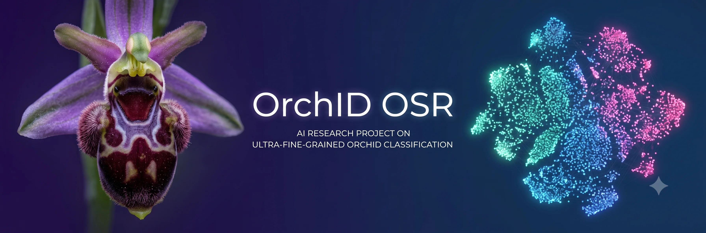

<p align="center">
  
</p>

<p align="center">
  <a href="README.it.md">🇮🇹 Italiano</a>
</p>

<p align="center">
  
  
  
  
  
  <br/>
  <em>Ultra-fine-grained classification and open-set recognition for <b>Ophrys</b> orchids via deep contrastive learning</em>
</p>

<p align="center">
  <strong>Master's thesis — University of Naples Federico II (DIETI)</strong>
  <br/>
  <a href="https://github.com/squidslab/OrchID">GitHub</a> ·
  <a href="https://arxiv.org/abs/2503.08049">SpHOR Paper</a>
</p>

---

## Abstract

Six morphologically similar *Ophrys* species, one held-out novel class (*O. garganica*), 2,192 training + 300 test images. We benchmark 6 architectures (ResNet‑18/50, ConvNeXt‑T/S, DINOv2‑S/B) × 3 learning paradigms (CE, SupCon, SpHOR). **Closed-set champion:** ResNet‑50 + CE (0.884 F1 test). **Open-set champion:** DINOv2‑Base + SpHOR (AUROC 0.875 on the held-out novel class). Open-set recognition remains architecture-dependent and far from solved in this ultra-fine-grained domain.

---

## Results (from thesis)

### Studio I-A (Exp 1) — Cross-Entropy Baseline

| Model | F1 Test |
|-------|:-------:|
| **ResNet‑50** | **0.884** |
| ResNet‑18 | 0.847 |
| DINOv2‑Base | 0.764 |
| DINOv2‑Small | 0.695 |
| ConvNeXt‑Tiny | 0.686 |
| ConvNeXt‑Small | 0.513 |

### Studio I-B (Exp 2) — Supervised Contrastive Learning

| Model | F1 Test |
|-------|:-------:|
| **DINOv2‑Base** | **0.808** |
| DINOv2‑Small | 0.710 |
| ConvNeXt‑Tiny | 0.573 |
| ConvNeXt‑Small | 0.450 |
| ResNet‑50 | 0.355 |
| ResNet‑18 | 0.287 |

### Studio I-C (Exp 3) — SpHOR (Open-World)

| Model | F1 Test |
|-------|:-------:|
| **DINOv2‑Base** | **0.833** |
| DINOv2‑Small | 0.772 |
| ResNet‑50 | 0.719 |
| ConvNeXt‑Tiny | 0.710 |
| ConvNeXt‑Small | 0.677 |
| ResNet‑18 | 0.442 |

### Studio II-A (Exp 4) — NCD (Open-Set Recognition)

| Model | F1 Test | AUROC (best detector) |
|-------|:-------:|:---------------------:|
| DINOv2‑Base | 0.928 | **0.875** (Ensemble) |
| **ConvNeXt‑Small** | **0.930** | 0.839 (Ensemble) |
| DINOv2‑Small | 0.924 | 0.758 (KNN) |
| ConvNeXt‑Tiny | 0.929 | 0.850 (Ensemble) |
| ResNet‑50 | 0.784 | 0.776 (KNN) |
| ResNet‑18 | 0.525 | 0.507 (Mahalanobis) |

*Studio II-A (Exp 4) excludes O. garganica from training, leaving it as the hidden novel class for open-set evaluation.*

### Studio II-B (Exp 5) — NCD with 2 Hidden Novel Classes

| Model | F1 Test (4 cls) | AUROC (Ensemble) |
|-------|:---------------:|:----------------:|
| **DINOv2‑Base** | **0.930** | 0.805 |
| ConvNeXt‑Tiny | 0.922 | **0.843** |
| DINOv2‑Small | 0.923 | 0.734 |
| ConvNeXt‑Small | 0.916 | 0.718 |
| ResNet‑50 | 0.878 | 0.634 |
| ResNet‑18 | 0.810 | 0.666 |

*Studio II-B (Exp 5) excludes O. garganica + O. majellensis (4 known classes). OSR scales (ConvNeXt-Tiny 0.843); GCD discovery collapses (SS-KMeans ACC new 0.12–0.38, NMI 0.92–0.95 stable). See thesis Sec. 4.5.*

---

## Key Findings

1. **Closed-set champion:** ResNet‑50 + CE (0.884 F1 test) — best accuracy overall; best contrastive DINOv2‑Base + SupCon (0.808)
2. **Open-set champion:** DINOv2‑Base + SpHOR (AUROC 0.875 on the held-out novel class) — best OSR in ultra-FGVC
3. **OSR is architecture-dependent:** best-detector AUROC ranges from 0.507 (ResNet‑18) to 0.875 (DINOv2‑Base); ResNet collapses under SupCon (F1 0.287/0.355) — BatchNorm × batch-8 hypothesis, unablated
4. **GCD splits in two:** SS-KMeans recovers known classes (ACC old up to 0.93) but novel discovery fails (ACC new ≈ 0, ResNet‑50 0.44 exception); uninformed K-means isolates the novel only on DINOv2‑Base (0.83 ± 0.03)
5. **Significant where it matters:** DeLong KNN vs Energy on DINOv2-Base +0.110, p = 0.0015

---

## Quick Start

### Local Development

```bash
# Backend
cd backend
pip install -e ".[dev]"
python server.py            # → http://localhost:5000

# Frontend
cd frontend
npm install
npm run dev                 # → http://localhost:5175
```

### Training

```bash
cd backend
python cli.py --cross-validate --exp 1 --model resnet18    # CE baseline
python cli.py --cross-validate --exp 2 --model resnet18    # SupCon
python cli.py --cross-validate --exp 3 --model resnet18 --sphor   # SpHOR
python cli.py --cross-validate --exp 4 --model dinov2_small --sphor   # NCD (hidden novel class)
python cli.py --ncd --exp 4 --model dinov2_small                  # OSR + clustering evaluation
python cli.py --cross-validate --exp 3 --model resnet18 --novel garganica,majellensis  # generic: 2 novel override
```

### Orchid CLI (Typer)

```bash
orchid --help
orchid train --help
orchid train --exp 4 --model dinov2_small --sphor
orchid figures --all  # rigenera le figure in documents/_figures/ (§3.5 riproducibile)
```

> `python cli.py` remains available as a deprecated alias for `orchid`.

See [AGENTS.md](AGENTS.md) for the full command reference.

---

## Experiments

| Studio | Exp | Method | Phases | Description |
|-----|--------|--------|--------|-------------|
| I-A | 1 | CE baseline | 1 (CE) | Standard cross-entropy, backbone + head trained jointly |
| I-B | 2 | SupCon | 2 (SupCon → CE) | Supervised contrastive pretraining → linear probe |
| I-C | 3 | SpHOR | 2 (SupCon+SpHOR → CE) | Orthogonal spherical prototypes for open-set regularisation |
| II-A | 4 | NCD | 2 (SupCon+SpHOR → CE) | O. garganica excluded as hidden novel class; OSR + clustering evaluation |
| II-B | 5 | NCD (2 novel) | 2 (SupCon+SpHOR → CE) | O. garganica + O. majellensis excluded as hidden novel classes; OSR + clustering evaluation |

All experiments use 5-fold stratified CV with seed 57 over 6 backbones.

---

## Dataset

| Species | Train | Test | Novel |
|---------|:-----:|:----:|:-----:|
| O. exaltata | 490 | 50 | |
| O. garganica | 563 | 50 | |
| O. incubacea | 352 | 50 | |
| O. majellensis | 152 | 50 | |
| O. sphegodes | 425 | 50 | |
| O. sphegodes Palena | 210 | 50 | |

*Train counts post MD5-dedup (2,192 total). O. garganica (row above) is used as the hidden novel class in Exp 4 (Studio II-A): excluded from training, reserved for test only.*

Download from HuggingFace: `snapshot_download("marcellorusso/orchid-osr-dataset", repo_type="dataset")`

---

## Deploy

Una sola immagine (`app`) su GHCR, costruita in CI e deployata con uno script:

- **Tag `v*`** → workflow GitHub → `ghcr.io/squidslab/orchid-app:<tag>` (con il `GITHUB_TOKEN` del repo), **GitHub Release con le note generate dai commit** e prune GHCR che tiene le 3 versioni più recenti
- **`scripts/deploy-vps.sh [tag]`** (default: ultimo tag) → `compose.yml` + `edge.yml` presi **dal tag**, `pull` + `up -d` in `/srv/orchid` → healthcheck in loopback (rollback al tag precedente se fallisce)
- **Nessun database:** tutto su filesystem (JSON, .pt, .npy); dataset e pesi su HuggingFace
- **Live demo:** https://osr.marrusso.dev

Si tagga quando una versione deve andare online (patch = fix, minor =
funzionalità, major = cambi incompatibili): i tag sono il registro delle
versioni pubblicate, non la cronologia dello sviluppo. Il deploy parte dalla
macchina di sviluppo perché l'SSH della VPS è aperto solo sulla tailnet;
l'host non ha il sorgente, prende solo l'immagine pinnata.

---

## References

- [SpHOR: Spherical Orthogonal Prototypes for Open-Set Recognition](https://arxiv.org/abs/2503.08049) — CVPR 2026 Findings
- [SupCon: Supervised Contrastive Learning](https://papers.nips.cc/paper/2020/hash/d89a66c7c80a29b1bdbab0f2a1a94af8-Abstract.html) — NeurIPS 2020
- [MGCE: Generalized Fine-Grained Category Discovery](https://arxiv.org/abs/2509.26227) — 2025
- [Generalized Category Discovery](https://openaccess.thecvf.com/content/CVPR2022/html/Vaze_Generalized_Category_Discovery_CVPR_2022_paper.html) — CVPR 2022

---

## Links

- **GitHub:** [squidslab/OrchID](https://github.com/squidslab/OrchID)
- **Models:** `marcellorusso/orchid-osr-models`
- **Dataset:** `marcellorusso/orchid-osr-dataset`

## License

[MIT](LICENSE)
